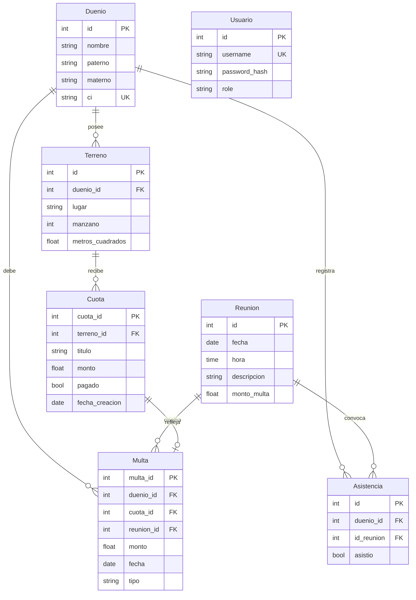

# Sistema de Registro y Catastro

Aplicación web para administrar el padrón de una junta vecinal: propietarios, terrenos, reuniones, asistencias, cuotas y multas, con reportes exportables a Excel y estados de cuenta imprimibles.


## Contenido

- [Qué hace](#qué-hace)
- [Tecnologías](#tecnologías)
- [Puesta en marcha](#puesta-en-marcha)
- [Variables de entorno](#variables-de-entorno)
- [Usuarios y roles](#usuarios-y-roles)
- [Estructura del proyecto](#estructura-del-proyecto)
- [Modelo de datos](#modelo-de-datos)
- [Reglas de negocio](#reglas-de-negocio)
- [Seguridad](#seguridad)
- [Pruebas](#pruebas)
- [Despliegue en Railway](#despliegue-en-railway)
- [Estado del proyecto](#estado-del-proyecto)

## Qué hace

| Módulo | Funciones |
| --- | --- |
| Propietarios | Alta, edición y baja; búsqueda por nombre, apellidos o CI |
| Terrenos | Lotes por manzano y superficie, asignados a un propietario |
| Reuniones | Convocatorias con fecha, hora y monto de multa por inasistencia |
| Asistencias | Registro de presentes y ausentes por reunión |
| Cuotas | Emisión de un aporte a todos los terrenos y control de pagos |
| Multas | Multas por inasistencia, por cuota impaga y manuales |
| Reportes | Balance de recaudación, exportación a Excel y estado de cuenta por propietario |
| Usuarios | Cuentas con rol de administrador o de consulta |

## Tecnologías

- **Backend:** Python 3.11, Flask 3.1, Flask-SQLAlchemy, Flask-Login, Flask-WTF (CSRF)
- **Base de datos:** SQLite (`app/sistema.db`). Lista para PostgreSQL con solo definir `DATABASE_URL`
- **Reportes:** openpyxl
- **Servidor de producción:** Gunicorn
- **Interfaz:** plantillas Jinja2 con Bootstrap 5 y Material Web
- **Pruebas:** pytest

## Puesta en marcha

Necesitas Python 3.11 o superior.

```bash
# 1. Clona el repositorio y entra en la carpeta
git clone https://github.com/Erickxdps/prueba-despliegue.git
cd prueba-despliegue

# 2. Crea y activa un entorno virtual
python -m venv .venv
source .venv/bin/activate        # En Windows PowerShell: .venv\Scripts\Activate.ps1

# 3. Instala las dependencias
pip install -r requirements.txt

# 4. Arranca la aplicación
python app/run.py
```

Abre <http://localhost:5000>. La primera vez se crean las tablas en `app/sistema.db`.

### Crea el primer administrador

La aplicación no trae usuarios ni contraseñas por defecto. Crea el tuyo con:

```bash
cd app
flask --app run crear-admin
```

Te pide el usuario y la contraseña (mínimo 8 caracteres). Para cambiar una contraseña existente:

```bash
flask --app run cambiar-password NOMBRE_DE_USUARIO
```

Como alternativa, si defines `ADMIN_PASSWORD` antes del primer arranque, el administrador se crea solo.

## Variables de entorno

| Variable | Obligatoria | Para qué sirve |
| --- | --- | --- |
| `SECRET_KEY` | Recomendada | Firma las sesiones. Si falta, se genera una temporal en cada arranque y las sesiones se cierran al reiniciar. Genera una con `python -c "import secrets; print(secrets.token_hex(32))"` |
| `DATABASE_URL` | No | Conexión a otra base de datos. Si falta, se usa `app/sistema.db`. Acepta `postgres://` y `postgresql://` |
| `ADMIN_USERNAME` | No | Usuario del administrador inicial (por defecto `admin`) |
| `ADMIN_PASSWORD` | No | Contraseña del administrador inicial. Solo se usa si la base no tiene usuarios |
| `APP_UTC_OFFSET_HOURS` | No | Zona horaria para las fechas (por defecto `-4`, Bolivia) |
| `PORT` / `HOST` | No | Puerto y dirección del servidor de desarrollo (`5000` y `0.0.0.0`) |
| `APP_ENV` | No | Ponla en `production` para forzar el modo producción fuera de Railway |

No hace falta definir ninguna para empezar: se usa SQLite y una clave de sesión temporal.

## Usuarios y roles

| Rol | Puede |
| --- | --- |
| `admin` | Todo: crear, editar y eliminar registros, y gestionar usuarios |
| `doctor` | Consultar todos los módulos y descargar reportes. No modifica nada |

Los nombres de rol vienen del código original. `doctor` equivale a "usuario de consulta".

## Estructura del proyecto

```
sistema-registro-catastro/
├── app/
│   ├── run.py              Fábrica de la app, configuración y comandos
│   ├── database.py         Instancia de SQLAlchemy
│   ├── models/             Entidades y reglas de negocio
│   ├── controllers/        Rutas (un blueprint por módulo)
│   ├── views/              Funciones que renderizan las plantillas
│   ├── templates/          Plantillas Jinja2
│   ├── static/             CSS y JavaScript
│   └── utils/              Decoradores, validadores, paginación y fechas
├── tests/                  Pruebas automatizadas
├── requirements.txt        Dependencias de producción
├── requirements-dev.txt    Dependencias para pruebas
├── Procfile                Arranque con Gunicorn
└── railway.toml            Configuración de Railway
```

El proyecto sigue el patrón MVC: los **modelos** contienen los datos y las reglas, los **controladores** reciben las peticiones y las **vistas** devuelven las plantillas.

## Modelo de datos



## Reglas de negocio

**Cuotas.** Una cuota se emite para todos los terrenos a la vez. La deuda es la cuota pendiente.

**Multas.** Hay tres clases:

| Clase | Cuándo existe | ¿Suma a la deuda? |
| --- | --- | --- |
| Reflejo de cuota | Mientras la cuota no esté pagada | No: la deuda ya está contada en la cuota |
| Inasistencia | Si el propietario no asistió y la reunión tiene multa | Sí |
| Manual | La crea un administrador | Sí |

**Deuda de un propietario** = cuotas pendientes de sus terrenos + multas de inasistencia + multas manuales.

**Inmunidad.** La propia junta (CI `555`, o nombre "JUNTA DE VECINOS") figura como propietaria de lotes y nunca recibe multas.

**Borrado de reuniones.** Al eliminar una reunión se eliminan también sus asistencias y sus multas de inasistencia.

## Seguridad

- Todas las pantallas con datos personales exigen iniciar sesión. Solo `/login`, `/reuniones` y `/health` son públicas.
- Los permisos se comprueban en el servidor en cada ruta, no solo ocultando botones.
- Todos los formularios y las llamadas AJAX llevan un token CSRF.
- Las contraseñas se guardan con hash (scrypt) y no hay credenciales en el código.
- Los listados paginados (inicio, propietarios, terrenos y asistencias) devuelven como máximo 100 registros por página.
- Las cookies de sesión son `HttpOnly` y `SameSite=Lax`, y `Secure` en producción.
- SQLite aplica las claves foráneas (`PRAGMA foreign_keys=ON`).
- No se puede dejar el sistema sin administradores.

Durante la fase de pruebas `app/sistema.db` viaja en el repositorio con datos de ejemplo. Antes de cargar datos reales, sácala de Git y usa una base externa. Los archivos `.env` ya están excluidos.

## Pruebas

```bash
pip install -r requirements-dev.txt
python -m pytest
```

Las pruebas nunca tocan `app/sistema.db`: cada una crea su propia base temporal con datos ficticios. Si existe un respaldo local en `backups/`, una prueba adicional recorre la aplicación sobre una copia de esos datos.

| Archivo | Qué comprueba |
| --- | --- |
| `tests/test_etapa1_seguridad.py` | Rutas protegidas, permisos por rol, límites de paginación, CSRF, secretos y configuración de producción |
| `tests/test_humo.py` | Que todas las páginas cargan, que los formularios guardan, fechas de multas, claves foráneas y que la base original queda intacta |

## Despliegue en Railway

1. Crea el proyecto en Railway desde este repositorio.
2. En las variables del servicio define `SECRET_KEY` para que las sesiones sobrevivan a los reinicios.
3. Si la base no tiene usuarios, define `ADMIN_PASSWORD` para el primer arranque.
4. Despliega. Railway arranca la aplicación con Gunicorn y la vigila en `/health`.

Por ahora el despliegue usa la base SQLite incluida en el repositorio. Railway restaura el disco en cada despliegue, así que **lo que se registre en producción se pierde al redesplegar**. Cuando necesites datos persistentes, añade un servicio PostgreSQL: Railway define `DATABASE_URL` y la aplicación lo usa sin cambiar código.

## Estado del proyecto

El sistema está en proceso de corrección tras una auditoría de 19 hallazgos.

**Hecho y probado**

- Seguridad: rutas protegidas, permisos, CSRF, secretos por variables de entorno y límites de paginación.
- Producción: dependencias completas, Gunicorn, healthcheck propio y configuración lista para PostgreSQL (opcional).
- Integridad: claves foráneas activas, fecha de las multas corregida y columna de contraseñas ampliada.

**Pendiente**

- Aplicar la regla del reflejo en los cálculos: el estado de cuenta y los reportes todavía suman la cuota y su multa.
- Unificar los endpoints de cuotas y reuniones en transacciones únicas.
- Errores conocidos: editar una multa falla porque falta su plantilla, y el formulario de terrenos no cambia el propietario.
- Script de migración de SQLite a PostgreSQL.
- Rediseño de la interfaz: paginación en todos los módulos, buscadores con autocompletado, modo oscuro y adaptación a móviles.
